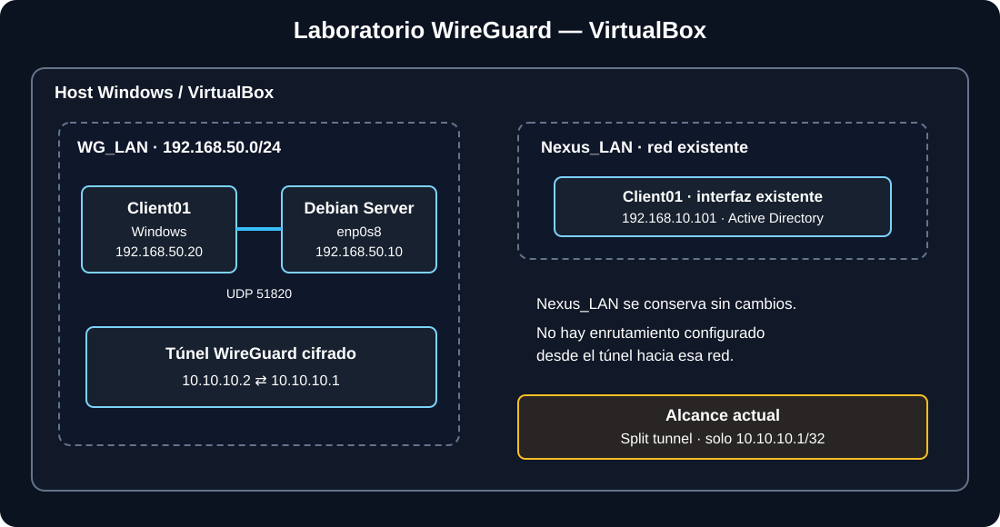

<div align="center">

# Laboratorio WireGuard en VirtualBox

**VPN de acceso limitado entre Debian Server y Windows Client**

[](https://www.wireguard.com/)
[](https://www.debian.org/)
[](https://www.microsoft.com/windows)
[](https://www.virtualbox.org/)

</div>

## Resumen

Despliegue y validación de un túnel WireGuard entre un servidor **Debian** y un cliente **Windows** dentro de Oracle VirtualBox. El laboratorio separa la red de transporte `WG_LAN` de la red existente de Active Directory `Nexus_LAN`.

> **Estado:** túnel funcional en el laboratorio local.  
> **Alcance:** túnel dividido (*split tunnel*) limitado a `10.10.10.1/32`. No es una VPN de túnel completo y no proporciona acceso automático a `Nexus_LAN`.

## Competencias demostradas

- Instalación y configuración de WireGuard en Debian.
- Generación y protección de claves públicas/privadas.
- Registro de peers y uso de `AllowedIPs`.
- Segmentación de redes virtuales en VirtualBox.
- Diagnóstico con `ip`, `wg`, `ping` y `systemctl`.
- Inicio automático mediante `systemd`.
- Documentación de pruebas, límites y mejoras.
- Buenas prácticas para no publicar secretos.

## Arquitectura



`WG_LAN` (`192.168.50.0/24`) es la red de transporte. WireGuard crea una red lógica cifrada (`10.10.10.0/24`) encima de ella. `Nexus_LAN` se conserva sin cambios.

## Direccionamiento

| Equipo/interfaz | Red | Dirección |
|---|---|---|
| Debian `enp0s3` | NAT VirtualBox | `10.0.2.15/24` (observada) |
| Debian `enp0s8` | `WG_LAN` | `192.168.50.10/24` |
| Debian `wg0` | WireGuard | `10.10.10.1/24` |
| Windows, interfaz existente | `Nexus_LAN` | `192.168.10.101` (observada) |
| Windows, segunda interfaz | `WG_LAN` | `192.168.50.20/24` |
| Windows, interfaz WireGuard | WireGuard | `10.10.10.2/24` |

Las direcciones observadas pueden cambiar en otros entornos.

## Cómo funciona

1. Windows alcanza el endpoint del servidor en `192.168.50.10:51820` mediante `WG_LAN`.
2. Los peers se autentican mediante sus claves WireGuard.
3. El cliente envía por el túnel únicamente el tráfico destinado a `10.10.10.1/32`.
4. Debian recibe ese tráfico por `wg0` (`10.10.10.1/24`).
5. El estado se valida mediante el handshake y pruebas ICMP.

## Resultados observados

| Prueba | Resultado |
|---|---|
| Ping Windows → Debian `192.168.50.10` | 4/4 respuestas |
| Interfaz `wg0` | Levantada correctamente |
| Handshake WireGuard | Confirmado en `sudo wg show` |
| Ping Windows → `10.10.10.1` por el túnel | 4/4 respuestas |
| Inicio automático | `wg-quick@wg0` habilitado |

Son resultados de esta práctica, no una auditoría de seguridad completa.

## Evidencias visuales

Añade capturas reales a `docs/images/` para mostrar:
- `wireguard-windows.png`: cliente WireGuard activo.
- `wg-show.png`: handshake reciente y transferencia, sin secretos.
- `ping-tunnel.png`: resultado de `ping 10.10.10.1`.
- `virtualbox-networks.png`: adaptadores virtuales, si resulta útil.

No se incluyen capturas simuladas como si fueran pruebas reales. Revisa las imágenes antes de publicarlas y oculta claves, contraseñas y datos sensibles.

## Estructura

```text
├── README.md
├── LICENSE
├── SECURITY.md
├── .gitignore
├── configs/
│   ├── server-wg0.conf.example
│   └── client-windows.conf.example
└── docs/
    ├── arquitectura.md
    ├── validacion.md
    ├── mejoras-futuras.md
    └── images/
        └── arquitectura.svg
```

## Reproducir el laboratorio

Consulta [`docs/arquitectura.md`](docs/arquitectura.md), las plantillas en [`configs/`](configs/) y las pruebas en [`docs/validacion.md`](docs/validacion.md). Las plantillas contienen marcadores que debes sustituir por los valores de tu entorno.

## Seguridad y límites

- Nunca publiques claves privadas ni configuraciones reales.
- El endpoint `192.168.50.10:51820` solo es accesible dentro del laboratorio local tal como está montado.
- No se ha configurado redirección de puertos en el router ni un endpoint público.
- No se ha configurado enrutamiento hacia `Nexus_LAN`.
- `AllowedIPs = 10.10.10.1/32` limita el tráfico enviado por el cliente a esa dirección.

Consulta [`SECURITY.md`](SECURITY.md).

## Mejoras futuras

- Añadir capturas reales de las pruebas.
- Probar persistencia tras reiniciar las máquinas.
- Documentar reglas de firewall explícitas.
- Explorar acceso controlado a una subred de pruebas.
- Automatizar comprobaciones del estado del túnel.

## Descripción para el CV

> Desplegué y documenté una VPN WireGuard entre Debian Server y Windows en VirtualBox, con redes virtuales segmentadas, autenticación mediante claves, servicio persistente con systemd y validación de conectividad mediante handshake y pruebas ICMP.

*Proyecto de laboratorio personal con fines educativos y de portfolio.*
