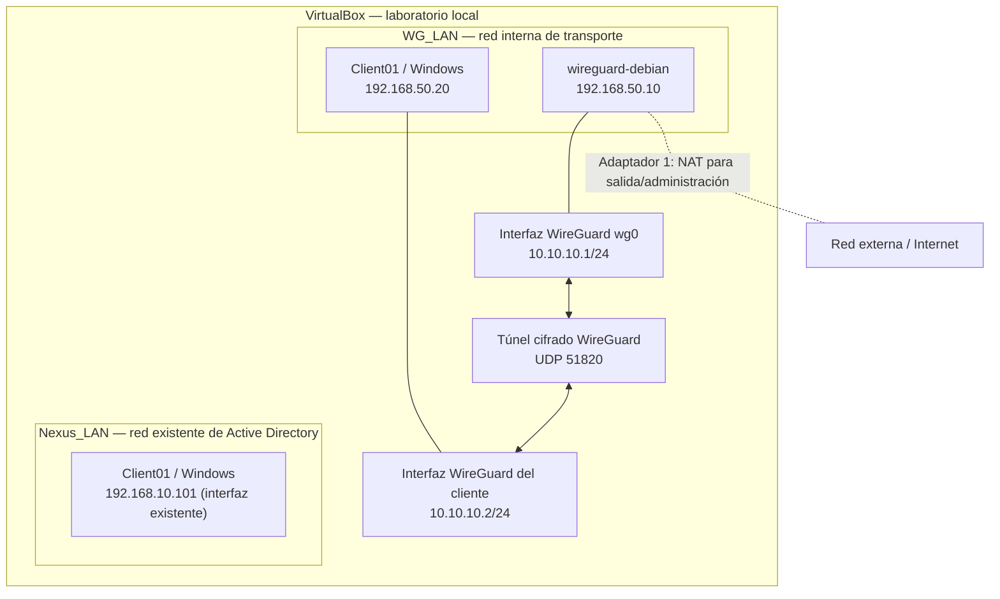

# Laboratorio WireGuard en VirtualBox

Laboratorio doméstico de redes y ciberseguridad: despliegue de una VPN WireGuard entre un servidor Debian y un cliente Windows, con claves criptográficas, segmentación de red y pruebas de conectividad.

> **Estado:** laboratorio funcional en entorno aislado de VirtualBox.  
> **Objetivo del repositorio:** documentar el diseño, la implementación, las pruebas y las decisiones de seguridad como proyecto de portfolio para puestos junior de sistemas, redes o ciberseguridad.

## Qué demuestra este proyecto

- Instalación y configuración básica de WireGuard en Debian.
- Creación y protección de claves públicas/privadas.
- Configuración de peers y `AllowedIPs`.
- Segmentación entre la red de transporte y la red virtual del túnel.
- Conectividad y diagnóstico mediante `ip`, `wg`, `ping` y `systemctl`.
- Inicio automático del servicio con systemd.
- Documentación de riesgos, limitaciones y siguientes mejoras.

## Arquitectura



### Direccionamiento

| Equipo/interfaz | Red | Dirección |
|---|---|---|
| Debian `enp0s3` | NAT VirtualBox | `10.0.2.15/24` (asignación observada en el laboratorio) |
| Debian `enp0s8` | `WG_LAN` | `192.168.50.10/24` |
| Debian `wg0` | Túnel WireGuard | `10.10.10.1/24` |
| Client01 — interfaz existente | `Nexus_LAN` | `192.168.10.101` (según `ipconfig`) |
| Client01 — segunda interfaz | `WG_LAN` | `192.168.50.20/24` |
| Client01 — interfaz WireGuard | Túnel WireGuard | `10.10.10.2/24` |

Las direcciones son específicas de este laboratorio y pueden cambiarse si se adapta la topología. `Nexus_LAN` se conserva para no alterar el laboratorio de Active Directory.

## Cómo funciona

1. Debian actúa como peer servidor y escucha en UDP `51820`.
2. Windows ejecuta el cliente oficial WireGuard.
3. Cada extremo tiene su propio par de claves. La clave privada no se comparte; la clave pública del peer se registra en el otro extremo.
4. El cliente dirige únicamente el tráfico destinado a `10.10.10.1/32` por el túnel.
5. Se valida el funcionamiento mediante el *handshake* y un `ping` a `10.10.10.1`.

Este diseño es un **túnel de acceso limitado**, no una VPN de túnel completo. No enruta todo el tráfico de Internet ni da acceso automático a `Nexus_LAN`.

## Requisitos

- Host Windows con Oracle VirtualBox.
- VM Debian Server con acceso de administración.
- VM Windows (`Client01`) con permisos para instalar WireGuard.
- Dos redes internas de VirtualBox: `Nexus_LAN` (existente) y `WG_LAN` (nueva).
- Conectividad entre Debian y Client01 por `WG_LAN`.
- Paquete `wireguard-tools` en Debian y aplicación oficial WireGuard en Windows.

## Implementación resumida

### 1. Redes de VirtualBox

- Debian: Adaptador 1 NAT; Adaptador 2 `Red interna` llamada `WG_LAN`.
- Client01: Adaptador 1 `Nexus_LAN`; Adaptador 2 `WG_LAN`.
- Verificar que el nombre `WG_LAN` coincide exactamente en ambos adaptadores.

### 2. Direcciones de `WG_LAN`

En Debian, identificar interfaces con:

```bash
ip -br addr
```

En este laboratorio `enp0s8` es la interfaz de `WG_LAN`. Para una asignación temporal de prueba:

```bash
sudo ip link set enp0s8 up
sudo ip addr add 192.168.50.10/24 dev enp0s8
```

En Client01, configurar la interfaz `WG_LAN` como `192.168.50.20`, prefijo `24`, sin puerta de enlace ni DNS en esa interfaz. La persistencia de la IP de Debian depende del gestor de red de la instalación y debe configurarse por separado.

Comprobar conectividad de transporte:

```bash
ping -c 4 192.168.50.20
```

Desde Windows:

```cmd
ping 192.168.50.10
```

### 3. Instalar WireGuard y crear claves en Debian

```bash
sudo apt update
sudo apt install wireguard
sudo install -d -o root -g root -m 700 /etc/wireguard
sudo sh -c 'umask 077; wg genkey > /etc/wireguard/server_private.key'
sudo sh -c 'wg pubkey < /etc/wireguard/server_private.key > /etc/wireguard/server_public.key'
```

Mostrar **solo** la clave pública del servidor cuando se necesite registrarla en el cliente:

```bash
sudo cat /etc/wireguard/server_public.key
```

No publicar claves privadas, configuraciones reales con claves ni capturas que las muestren.

### 4. Configuración de ejemplo del servidor

Consultar [`configs/server-wg0.conf.example`](configs/server-wg0.conf.example). Sustituir los marcadores por las claves correspondientes. Proteger el archivo:

```bash
sudo chown root:root /etc/wireguard/wg0.conf
sudo chmod 600 /etc/wireguard/wg0.conf
```

Activar y comprobar:

```bash
sudo wg-quick up wg0
sudo wg show
sudo systemctl enable wg-quick@wg0
```

Si la interfaz ya está activa, no volver a ejecutar `wg-quick up wg0`; para aplicar cambios hay que seguir un procedimiento controlado y verificar el estado del servicio.

### 5. Configurar Windows

Instalar la aplicación oficial desde [wireguard.com/install](https://www.wireguard.com/install/). Crear un túnel vacío, conservar la clave privada que genera la aplicación y usar como base [`configs/client-windows.conf.example`](configs/client-windows.conf.example).

Registrar la clave pública del cliente en el bloque `[Peer]` del servidor, con `AllowedIPs = 10.10.10.2/32`. Activar el túnel y comprobar el estado en Debian:

```bash
sudo wg show
```

Una línea `latest handshake` reciente confirma que se completó el intercambio criptográfico. A continuación, desde Windows:

```cmd
ping 10.10.10.1
```

## Resultados observados

En la prueba realizada en el laboratorio:

- Debian mostraba `wg0` con `10.10.10.1/24` y puerto UDP `51820`.
- El peer de Windows estaba registrado con `AllowedIPs = 10.10.10.2/32`.
- `wg show` mostró `latest handshake` reciente y contadores de tráfico.
- Windows recibió respuestas al hacer `ping 10.10.10.1` (4 enviados, 4 recibidos, 0 % perdidos).

Estos resultados validan el túnel entre los dos peers. No demuestran acceso remoto desde Internet, enrutamiento a `Nexus_LAN` ni salida a Internet a través de WireGuard; esas funciones no forman parte de esta versión.

## Seguridad y límites

- No subir claves privadas, QR con configuración, archivos de configuración reales ni contraseñas a GitHub.
- Los archivos de este repositorio son **plantillas** con marcadores, no configuraciones listas para copiar sin editar.
- La IP de endpoint `192.168.50.10` solo es alcanzable dentro de la red de laboratorio; no es un endpoint público.
- No se ha habilitado reenvío IP, NAT de salida ni `AllowedIPs = 0.0.0.0/0`.
- No se ha expuesto el puerto UDP `51820` al router ni a Internet.
- `WG_LAN` es una red interna de VirtualBox; por sí sola no proporciona acceso a Internet.
- `AllowedIPs` no sustituye a las reglas de firewall ni a una política de mínimo privilegio.
- Para producción se necesitarían revisión de firewall, actualizaciones, estrategia de recuperación de claves, monitorización y pruebas adicionales.

## Próximas mejoras

- [ ] Hacer persistente la IP estática de Debian según el gestor de red usado.
- [ ] Validar un reinicio de Debian y comprobar el inicio automático de `wg0`.
- [ ] Añadir un segundo peer (PC anfitrión) con claves independientes.
- [ ] Documentar pruebas de firewall y alcance de `AllowedIPs`.
- [ ] Añadir un diagrama de flujo de paquetes y una matriz de pruebas.
- [ ] Explorar un escenario separado de acceso a una subred, con reglas explícitas.
- [ ] Si se crea una prueba de túnel completo, usar una red/VM aislada y documentar reenvío, NAT, DNS e IPv6 por separado.

## Estructura del repositorio

```text
wireguard-lab-portfolio/
├── README.md
├── LICENSE
├── .gitignore
├── SECURITY.md
├── configs/
│   ├── server-wg0.conf.example
│   └── client-windows.conf.example
└── docs/
    ├── arquitectura.md
    ├── validacion.md
    └── mejoras-futuras.md
```

## Presentación en el CV

**Laboratorio doméstico — WireGuard VPN con Debian y Windows (VirtualBox)**  
Diseñé y documenté un laboratorio segmentado con Debian como servidor WireGuard y Windows como cliente. Configuré claves criptográficas, peers, direccionamiento IP, arranque automático con systemd y validé el túnel mediante handshake y pruebas ICMP. Documenté límites de seguridad y mejoras futuras.

Adapta esta descripción a lo que hayas implementado y puedas explicar en una entrevista.
